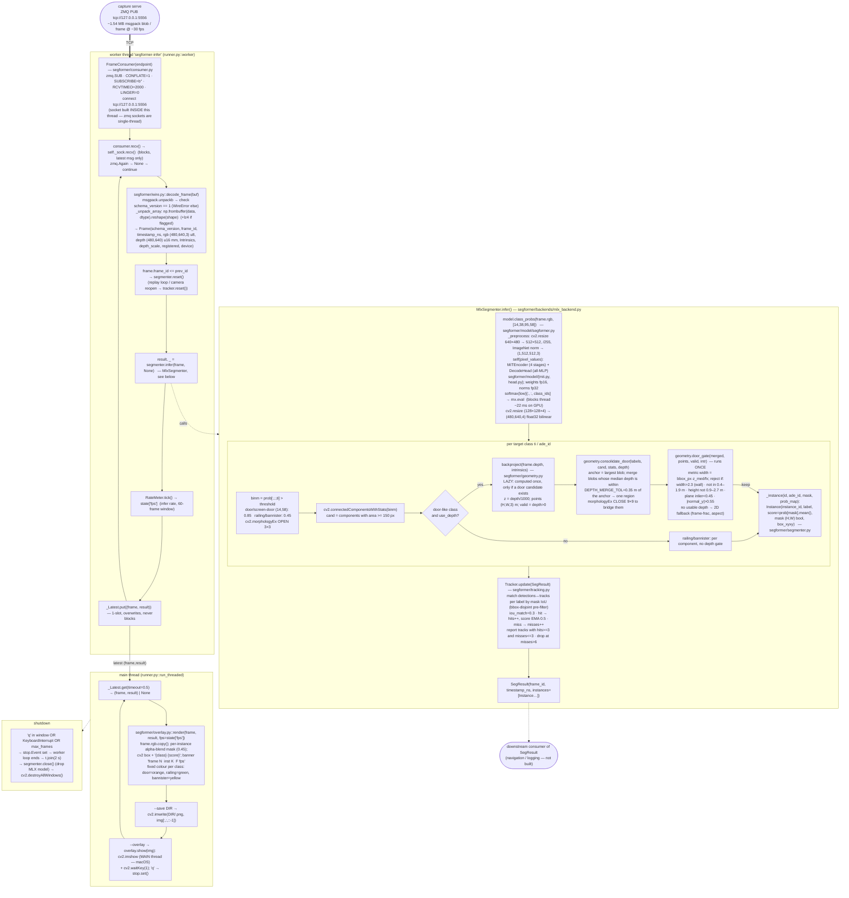

# Data flow — `segformer run` (door/railing segmentation service)

Process: `python -m segformer run --backend mlx --overlay` (native **arm64**,
`segformer/.venv`, system python3.14). Consumes the schema-v1 ZMQ stream from
`capture serve`. Entry: `segformer/cli.py::cmd_run`.

Two run modes:
- **threaded** (default for `--overlay` / `--save`) — `segformer/runner.py::run_threaded`
- **serial** (`--no-thread`, and the `print` mode) — the loop in `cmd_run`

## Serial mode (`--no-thread`)

Same stages, one thread, fully sequential per frame:
`consumer.frames()` → `decode_frame` → `seg.infer` → `overlay.render` →
`imwrite` / `imshow`. Everything (decode ~4 ms, infer ~29–39 ms, overlay ~1–4 ms,
imshow ~10 ms) adds up per frame. Threaded mode overlaps the non-infer work with
the next frame's inference.

## Key facts

| thing | value / location |
|---|---|
| process arch | native arm64 (`segformer/.venv`, python3.14) |
| model | SegFormer MiT-B0, ADE20K-150, ported to MLX; `segformer models` registry, weights `weights/segformer-b0-ade/model.mlx.safetensors` |
| model input | 512×512, ImageNet-normalized; output logits at 128×128×150 |
| targets | ADE ids 14 door, 38 railing, 95 bannister, 58 screen-door (`model/config.py::ADE20K_TARGETS`) |
| precision stack | (1) prob>0.85 not argmax → (2) `consolidate_door` merges same-depth blobs → (3) `door_gate` once → (4) temporal `Tracker` |
| GPU | MLX / Metal; `mx.eval` + `np.array` block the calling thread ~22 ms — GPU work is offloaded, the thread is not free |
| threads | 2 — worker (recv+decode+infer), main (overlay+imshow). `imshow` must be main-thread on macOS. `segmenter.infer` only ever called from the worker. |
| handoff | `runner._Latest` — 1 slot, latest-wins, producer never blocks |
| perf | infer ~29 ms (no door) / ~39 ms (door); threaded effective ~26 fps on a session2 replay |
| flicker | `Tracker`: 3 hits to confirm, lingers 6 frames (`min_hits`, `max_misses`) |
| coupling to xtion | none — `wire.py` + `frame.py` are an independent copy of schema-v1, guarded by `WIRE_SCHEMA_VERSION` |
