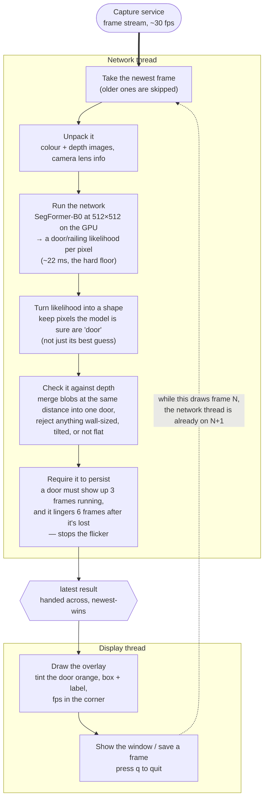

# Data flow — segmentation service

Subscribes to the capture service's frame stream, finds doors and railings in
each frame with a neural network on the Mac GPU, and draws the result. Two
threads: one does the network, the other draws.

## Notes

- **Why two threads.** The network call blocks its thread for ~22 ms waiting on
  the GPU. Drawing and unpacking (~15 ms) run on the other thread in that gap
  instead of adding to each frame. Effective rate ~26 fps; `--no-thread` runs it
  all in one thread if you want.
- **Why SegFormer, not the model in the name.** The job is *semantic
  segmentation* of fixed structure (doors, railings), not video object tracking.
  SegFormer is pretrained on a dataset that already has "door" and "railing".
- **The model is weak on its own** (small, general-purpose). Precision comes
  from the depth check and the persistence rule, not the network.
- **No shared code with capture.** This service has its own copy of the message
  format; a version mismatch is rejected, never misread.

Stage-by-stage detail and tuning knobs: [`../HANDOFF.md`](../HANDOFF.md).
