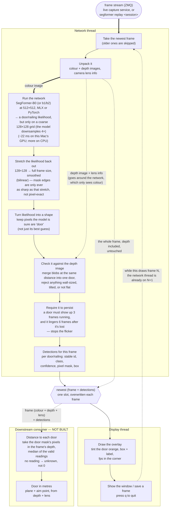

# Data flow — segmentation service

Subscribes to an RGB-D frame stream — a live capture service, or a recorded
session replayed with `segformer replay` — finds doors and railings in each
frame with a neural network on the GPU, and draws the result. Two threads: one
does the network, the other draws.

Everything about the stream (contract, codec, recording, replay, subscribe) is
the `stream/` package, separate from the net. The network runs through one of
two backends, same pipeline after it: **MLX** on Apple Silicon, or **PyTorch**
(CUDA / MPS / CPU) elsewhere. Pick with `--backend`, `$SEGFORMER_BACKEND`,
else `mlx`.

## Notes

- **Why two threads.** The network call blocks its thread while the GPU works
  (~22 ms on this Mac). Drawing and unpacking (~15 ms) run on the other thread
  in that gap instead of adding to each frame. Effective rate ~26 fps;
  `--no-thread` runs it all in one thread if you want.

- **The overlay is a debug view, not the output.** The product is the
  per-frame detection list (`SegResult`: for each door/railing — a stable id,
  the ADE20K class, a confidence, a pixel mask, a box). The overlay just draws
  it for a human. A real consumer (navigation, not built) would take that list
  plus the frame's depth and lens parameters and back-project the door into
  metres.
- **Distance is not a segformer output.** The network sees the colour image
  only. Depth is used inside this service for one thing — the keep/reject check
  on each door — and no distance is kept from it. The frame, depth included,
  rides along untouched in the handoff; a consumer that needs distance takes
  the door mask, looks up those pixels in the frame's depth, and computes it
  itself. Nothing in the network thread produces or smooths a distance.
  What the consumer has to cope with:
  - *Sensor range.* The Xtion reads depth only from roughly 0.8 m to 3.5 m.
    Closer, or on a glass/reflective door, there is no reading — and the depth
    check here keeps such doors anyway, so a detection can arrive with no
    usable depth under its mask. Distance is then unknown, not zero.
  - *Mask edges.* The mask is a stretch of the 128×128 grid (note below), so
    its rim is blurry and bleeds onto the wall or floor behind the door. Use
    the median of the mask's interior, not every pixel, or the number gets
    dragged toward the background.
  - *Frame to frame.* A single frame's median is noisy. The detection's stable
    id is what lets the consumer follow one door across frames and smooth its
    distance per id.
- **The model is weak on its own** (small, general-purpose). Precision comes
  from the depth check and the persistence rule, not the network.
- **The network's own output is 128×128, not frame resolution.** SegFormer's
  decode head runs at input/4 (512/4) regardless of model size (b0/b1/b2 all
  share `strides=(4,2,2,2)`) — every downstream mask is a bilinear stretch of
  that coarse grid, so boundaries are never sharper than a ~4px-at-512 block,
  whatever the original camera resolution is.
- **No shared code with the camera side.** `stream/` carries its own copy of
  the frame contract; a version mismatch is rejected, never misread.

Stage-by-stage detail and tuning knobs: [`../HANDOFF.md`](../HANDOFF.md).
