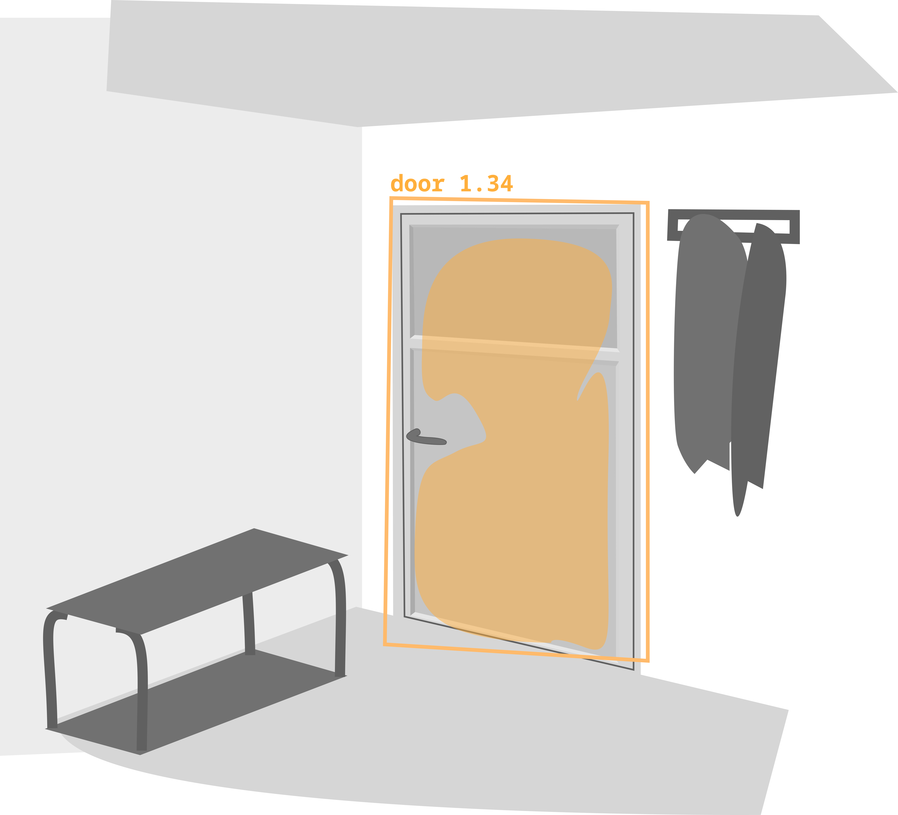
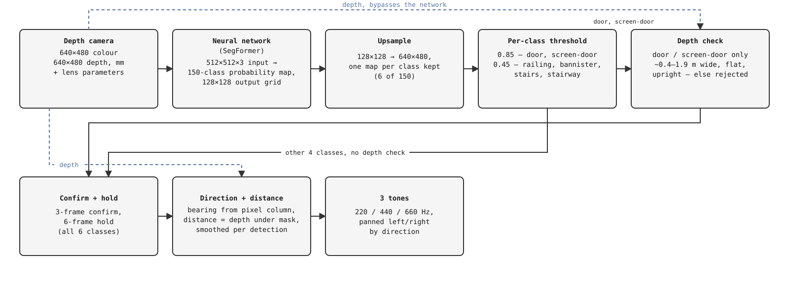
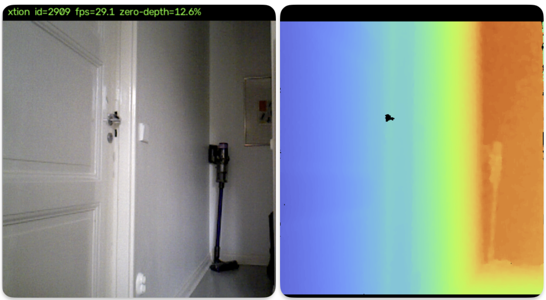
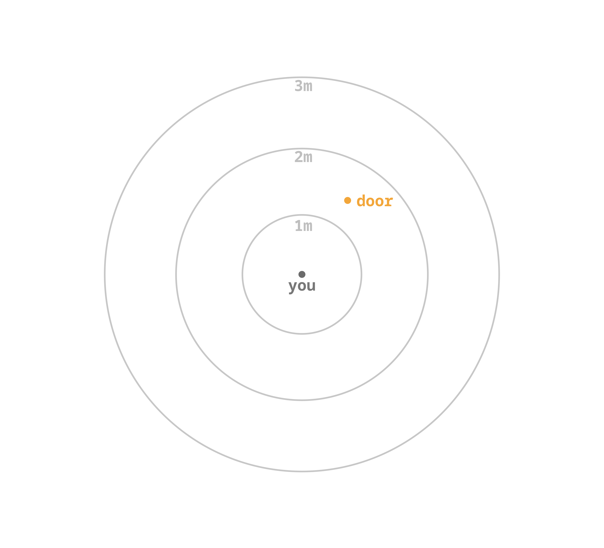

# Help for Visually Impaired with Auditory Navigation — Technical Report

26.10.2026  
Atte Pajula, Patrik Pakkanen, Ebru Yaman  
Project Report for DATA11001  
University of Helsinki  
## 0. Introduction

Several assistive devices already help a blind or visually impaired user
get around safely. There are smart canes, obstacle-avoidance wearables, sensors that
warn about what is in the way, some of them providing a real improvement in everyday ease of life. They share one focus: what to avoid. This project points the same kind of hardware at the opposite question — not
what is blocking the path, but what is useful on it. A door, a railing, a
flight of stairs: not hazards, but the landmarks a person actually
navigates by. This is a proof of concept for finding those, with a depth
camera and a neural network, worn or carried by the user.

A screen is no use here, and braille is too slow for something that has to
update as the user walks. Natural language's directional vocabulary is coarse. Sound in a form of signal tone  is the only channel that fits. It reaches the user continuously, without taking their hands or attention away from
walking, and it already carries direction and distance naturally. A
person does not have to learn what "to the left" actually means.

This is a proof of concept, not a finished product. A depth camera watches
the environment the user is walking through. The system finds doors,
railings, and stairs in what it sees, and turns each one into a sound signal, a
tone that comes from the right direction, at a loudness that tells the
user how far away it is.

This report follows one frame of data on that trip: camera, network, a few
filtering steps, and out as sound. It does not try to cover every file or
every flag, the project's `README.md` does that. Each section below ends
with what the data looks like by the time it leaves that stage, so its
shape is traceable all the way through: raw colour and depth in, one short
tone out.

### Pipeline at a glance

  

Two things to notice: the depth check only runs for door and screen-door.
The other four classes skip it and reach the tracker directly. And depth
never enters the neural network at all (dashed lines). It travels
alongside the colour image, straight from the camera to the stages that
need it: the depth check, and distance.

## 1. Where the data starts

One frame starts as two images and a few numbers.

The colour image is 640×480 pixels, 3 channels, one byte per channel
(red, green and blue, stored in that order, not OpenCV's usual blue-green-red;
the display code flips it just before showing it, not before using it). The
depth image is the same 640×480 size but one channel: a 16-bit number per
pixel, in millimetres, where 0 means no reading. The two are pixel-aligned: pixel (x, y) in one is the same physical point as pixel (x, y) in the
other. That alignment is not automatic: the depth sensor and the colour lens
sit a few centimetres apart on the device, so one has to be remapped into
the other's point of view before the two line up. That work is already
done by the time a frame reaches this pipeline.

A real frame, side by side: colour on the left, depth colourised on the
right, near shaded blue and far shaded orange so the gradient reads at a
glance. The small black spot partway up the depth image is a zero-depth
pixel. It is chrome door handle and the sensor simply could not measure it due to reflectivity. A handful of pixels like that are normal in almost every
frame; what matters later is whether they land inside something the
system is trying to measure.

Alongside the two images: the camera's lens parameters which are focal length and
optical centre, in pixels, one pair per axis (fx, fy, cx, cy). These do not
describe the scene; they describe the camera itself, and they're what
later turns "pixel column 400, depth 2.3 m" into an actual angle and a
real-world sideways offset. There's a
frame id, so detections can be matched up frame to frame, and a
timestamp.

The depth sensor also has a real, physical range: roughly 0.8–5 m.
Closer than that, farther than that, or pointed at glass or a mirror, a
pixel just reads zero — no reading, not a wrong one. A door's own glass panel
can blank out part of its own detection this way. That gap in the data
does not get patched here, since it is a hardware related issue.

This frame comes from one of two sources, and they're indistinguishable
once it arrives: a live Xtion camera, or a previously recorded session
played back with `segformer replay`. Nothing downstream can tell which, so a recording can stand in for the camera during
development.

What leaves this stage: one frame (colour image, depth image, lens
parameters, id, timestamp). Nothing has been computed yet.

## 2. Going over the wire

The frame is packed into a single message: the header fields (id,
timestamp, intrinsics, …) plus the colour and depth arrays, each as its
raw bytes alongside its dtype and shape, so the other end can rebuild the
exact same array without guessing. Nothing is resized, recoloured, or
otherwise changed. By default nothing is compressed but an lz4
option exists for it, and it is quite useful since uncompressed feed is 44 megabytes per second.

This goes out over ZeroMQ as a publish/subscribe stream, one message per
frame. The consumer side keeps only the newest one: if it is slower than the camera, older frames are dropped instead of getting queued up. Because of this there is no backlog to catch up on.

What leaves this stage: the same frames serialized over network thread.

## 3. Into the network

Only the colour image goes into the network (depth sits this stage out
entirely). It's resized from 640×480 down to 512×512 (bilinear), scaled to
the 0–1 range, then normalized with fixed ImageNet statistics (the same
mean and standard deviation the model was trained against, one triplet
each for red, green, blue). This exact recipe is what HF's own SegFormer
preprocessor does by default. Matching it is not optional, since the
network was trained against images prepared that way.

Either backend for the SegFormer, MLX or PyTorch, runs the identical recipe and the same
network weights. The backend choice only changes which hardware does the
arithmetic, not the numbers that come out (see "Known limits" in the
project's `README.md` for the small amount of float drift that exists
between the two anyway).

The network itself is a 150-class classifier (trained on ADE20K's full label set)
run per pixel at its own native, coarse 128×128 grid (the architecture
downsamples by 4×, regardless of model size). A softmax turns that into a
probability per class per pixel; only the 6 classes this project tracks
(door, screen-door, railing, banister, stairs, stairway) are kept, the
other 144 are discarded here.

What leaves this stage: a probability, 0 to 1, for 6 classes, at every
point of a 128×128 grid. Not yet a detection, and not yet at the frame's
own resolution.

## 4. From probabilities to shapes

Up to here the data is a grid of numbers: a probability per pixel, per
class, not yet a shape. Turning that into something usable happens in
four steps, run once per class.

First, the 128×128 grid is stretched back to the frame's own 640×480, the
same bilinear blur used earlier to fit it to the network. A mask's edge
is never sharper than that stretch.

Second, each pixel is kept or dropped by a threshold: 0.85 for door and
screen-door, 0.45 for the rest. Argmax ("highest score wins, whatever the
number") is not used here, since on a door it eats into the wall beside
it.

Third, door and screen-door only. The raw output usually comes back as
several disconnected blobs for one physical door. Blobs at the same
depth merge into one mask per door, so a second door farther away stays
separate. Each merged shape also has to pass a depth check: roughly
door-sized (0.4–1.9 m wide), flat, upright, tolerant of a door only
partly in frame. Failure of either checks results to shape being dropped. Railing, banister,
stairs, and stairway skip this step; nothing depth-based filters them
today.

Fourth, a shape has to persist: three frames running to be reported,
lingering six frames after it is lost, so one missed frame does not
flicker a detection on and off.

What leaves this stage: a list of detections, each with a stable id,
class, confidence score, mask, and box, the door and its orange outline
in §0's figure, drawn.

## 5. Turning a detection into a place in space

A detection, at this point, is a shape in a 2D image. Converting it into a
direction and a distance is the responsibility of this stage, not the
network, which never receives depth as input.

Distance is derived from the depth image, sampled within the detection's
mask. The mask's outer rim is eroded by five pixels first, since the
upsampling in §4 leaves that rim blurred and liable to include background
pixels. If the eroded region contains at least fifty valid depth readings,
their median becomes the object's distance. Below that threshold, distance
is recorded as unknown rather than estimated.

Direction, or bearing, is computed from the horizontal pixel position of
the detection and the camera's lens parameters (focal length and optical
centre), using the same pinhole relationship introduced in §1. This value
does not depend on a successful depth reading: bearing remains available
even when distance does not.

Both values are smoothed per detection across frames using an exponential
moving average, so a single noisy reading does not cause a visible jump.
A detection that stops appearing is retained briefly, then discarded if it
is not seen again within ten updates.

What leaves this stage: a cue per detection, a bearing in radians, a
distance in metres (or none), and the detection's identity, class, and
label, carried forward from §4.

## 6. Turning a place in space into a sound

This is the final stage, and the one the preceding six exist to serve: a
cue, consisting of a class, a bearing, and a distance, becomes something
audible.

Each of the three sound classes is assigned a fixed pitch: 220 Hz for
door, 440 Hz for railing, 660 Hz for stairs. Where more than one object of
a class is in view, the nearest one determines the tone for that class;
the others do not add a second tone.

Loudness encodes distance. A detection within one metre is played at full
volume; beyond that, loudness falls off with distance. A detection with no
usable depth reading, from §5, is still played, at a fixed, reduced
volume, so that bearing remains communicated even without a distance.

Direction is encoded twice, not once. Volume differs between the left and
right channel according to bearing, and in addition, the near channel
leads the far channel by a short interval, on the order of a millisecond.
This second cue, an arrival-time difference rather than a volume
difference, is closer to how human hearing actually localises a source,
and was added because volume alone read as flat for small angles.

The three classes may be muted individually, by pressing 1, 2, or 3. Since
the intended user cannot see a screen, this action is confirmed by sound,
not by text: a single descending tone for mute, two ascending tones for
unmute. A visual indicator exists as well, for a developer at a terminal,
but it is not the primary channel.

The keyboard is a placeholder. There is no keyboard on a device the user
would actually wear or carry; 1, 2, and 3 stand in for whatever physical
input that device will have, such as a small set of buttons. Any such
signal can drive the same mute logic with a small code change, since the
toggle itself does not depend on how it is triggered.

## 7. Table 1. Summary of data manipulation stages

Stages of the data manipulation, and the properties of the data that leaves that stage (consequently entering the next stage) are given.

| § | stage | data, leaving |
|---|---|---|
| 1 | capture | one `Frame`: 640×480×3 colour, 640×480 depth, intrinsics |
| 2 | wire | the same frame, serialized to one message |
| 3 | network | probabilities, 6 classes, 128×128 grid |
| 4 | filtering | a list of detections, each with an id, a mask, a box |
| 5 | localisation | a list of cues: bearing, distance (or none), per id |
| 6 | audio | a continuous stereo signal |

## 8. Open gaps and reflection

The depth source is the one part of this journey that most plainly needs
replacing. The Xtion is a structured-light sensor: it projects an infrared
pattern and reads its distortion, a method that fails outdoors in direct
sunlight, where ambient infrared overwhelms the projected pattern. A
device meant to be worn outside needs a depth source that does not share
this failure mode, such as a lidar sensor, which measures distance
directly by time of flight and does not depend on a projected pattern at
all.

This change is confined to the capture side. §1 established that a frame
is just a colour image, a depth image, and a small set of parameters
describing the sensor, and §2 that this is serialized into one message and
published over ZeroMQ without interpretation. Nothing downstream of that
publication, from the subscriber in §2 onward, inspects where the depth
values came from. Replacing the Xtion with a lidar sensor means producing
the same `Frame` contract from different hardware; it does not require a
change to the network, the filtering stage, the localisation stage, or the
audio stage.

In terms of design process and planning, we faced issues in determining who this project would serve. We suspected from the beginning that we were unlikely to create an application usable by the target audience, because of challenges relating to developing for consumer products like mobile phones. So we decided to stick with the hardware we had, and focus more on the conceptual benefits this project may provide. We thought that this might be useful for various robotics applications, but decided to limit our focus to navigation for people. This also lead us to make our final delivery a website in which we present our project. We aimed to make the website easily accessible to screen readers, and kept it structurally simple for easy navigation through the text blocks. The website and reading experience could be further improved by adding accommodations for low-vision readers, such as a menu for adjusting the font size and style. This project has been a valuable learning experience for data science, project design and organisation for all of us.

Claude Sonnet 6 was used to polish, improve and language-check this report.
